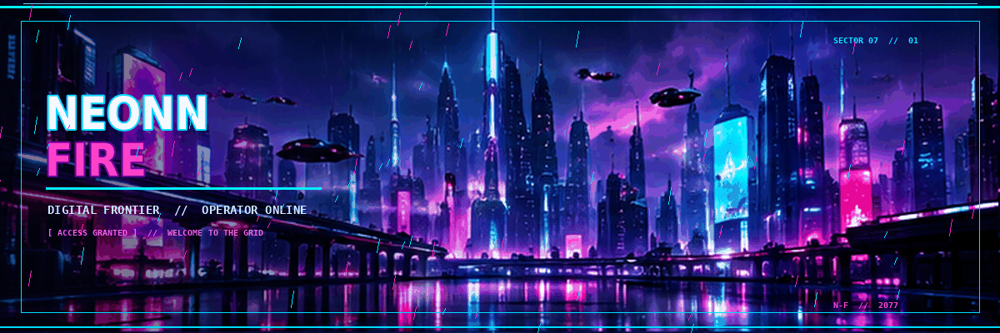

<div align="center">




</div>


## ░▒▓ SYSTEM / OPERATOR PROFILE

```text
┌──────────────────────────────────────────────────────┐
│  NEONN FIRE  //  DIGITAL OPERATIVE                    │
├──────────────────────────────────────────────────────┤
│  STATUS       : ONLINE                                │
│  ENVIRONMENT  : THE NEON GRID                         │
│  DIRECTIVE    : BUILD  /  EXPERIMENT  /  EVOLVE        │
│  ACCESS       : PUBLIC REPOSITORIES                   │
└──────────────────────────────────────────────────────┘
```

## ⟁ ABOUT THE OPERATOR

Welcome to my corner of the digital underground. This profile is my development log: a place for code, experiments, projects, and new things I'm learning.

**Signal:** curiosity, creativity, and continuous improvement.


## ⌁ PROJECT ARCHIVE

Explore the repositories for current builds, experiments, and source code.

<div align="center">

[](https://github.com/NeonnFire?tab=repositories)
[](https://github.com/NeonnFire)

</div>

## ⌬ LIVE TELEMETRY

<div align="center">


</div>


## ◈ CONNECT / TRANSMISSION

<div align="center">

[](https://github.com/NeonnFire)

```text
> handshake initiated...
> identity confirmed: NEONN FIRE
> encrypted channel open.
> END OF TRANSMISSION_
```

**STAY CURIOUS. KEEP BUILDING. OWN THE NIGHT.**


</div>
