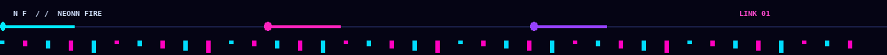
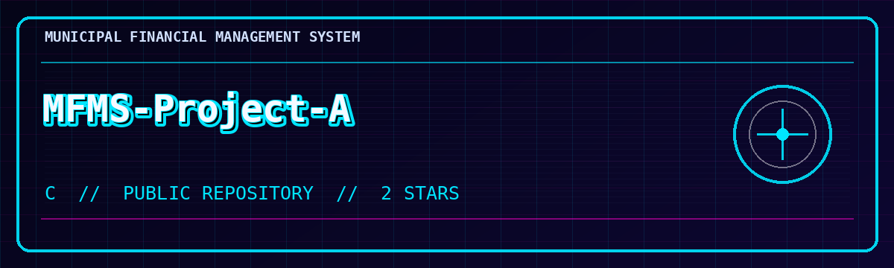
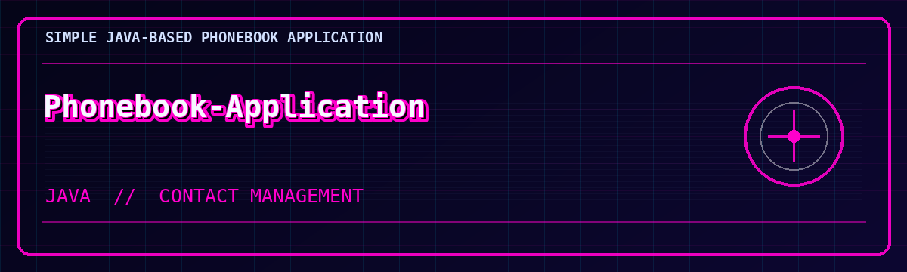
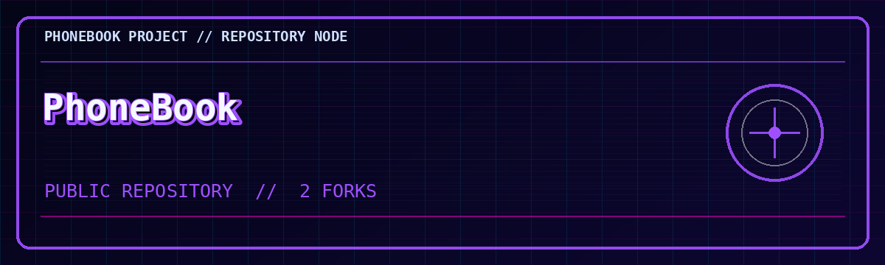

<div align="center">


</div>

<div align="center">

<a href="https://github.com/NeonnFire">

</a>

</div>


---



## `01 // OPERATOR PROFILE`

```text
╔══════════════════════════════════════════════════════════════╗
║  HANDLE       NEONN FIRE                                     ║
║  PLATFORM     GITHUB                                         ║
║  MODE         DEVELOPER / BUILDER                            ║
║  STATUS       ONLINE                                         ║
║  DIRECTIVE    LEARN // BUILD // IMPROVE                      ║
╚══════════════════════════════════════════════════════════════╝
```

Welcome to my corner of the grid. This profile is my public project log: a place for software experiments, programming work and things I'm building as I develop my skills.

**Current focus:** building, improving and documenting practical software projects.


## `02 // TECHNOLOGY MATRIX`

The repositories shown on this profile span these languages:

<div align="center">


</div>

**Language breakdown shown for the `NeonnFire` repository:**

<div align="center">


</div>

Other repositories shown on this account include work labelled **C** and a **Java-based Phonebook Application**.


## `03 // PUBLIC PROJECT ARCHIVE`

<div align="center">

<a href="https://github.com/NeonnFire/MFMS-Project-A">
  
</a>

**[MFMS-Project-A](https://github.com/NeonnFire/MFMS-Project-A)**

C repository · 2 stars shown in the supplied profile screenshot

<br/>

<a href="https://github.com/NeonnFire/Phonebook-Application">
  
</a>

**[Phonebook-Application](https://github.com/NeonnFire/Phonebook-Application)**

A simple Java-based Phonebook Application for managing contacts.

<br/>

<a href="https://github.com/NeonnFire/PhoneBook">
  
</a>

**[PhoneBook](https://github.com/NeonnFire/PhoneBook)**

Public repository · 2 forks shown in the supplied profile screenshot

</div>


## `04 // DEVELOPMENT ACTIVITY`

<div align="center">


</div>

### `ACTIVITY LOG // NOVEMBER 2026 SNAPSHOT`

The supplied profile screenshots show:

- **39 contributions** in the last year.
- **9 commits across 3 repositories** in the November activity shown.
- `NeonnFire/NeonnFire` — 7 commits.
- `NeonnFire/Hope-For-Humanity` — 1 commit; this repository appeared private in the screenshot.
- `NeonnFire/MFMS-Project-A` — 1 commit.
- **2 repositories created** on November 2, 2026: `NeonnFire` and `Hope-For-Humanity`.

These are dated profile figures, not live counters.


## `05 // CONNECT TO THE GRID`

<div align="center">

<a href="https://github.com/NeonnFire">
  
</a>

<a href="https://github.com/NeonnFire?tab=repositories">
  
</a>

```text
> UPLINK ESTABLISHED
> IDENTITY: NEONN FIRE
> STATUS: BUILDING
> END OF TRANSMISSION_
```


**STAY CURIOUS. KEEP BUILDING. OWN YOUR CORNER OF THE GRID.**


</div>
